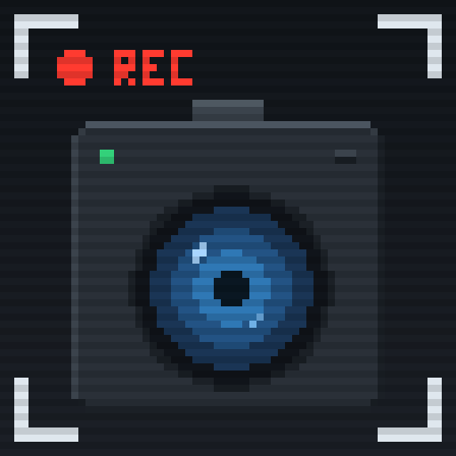

# 🔴 CameraOverhaul: Bodycam Edition

<p align="center"></p>

**By T2ws**

**Your camera is strapped to your chest.** Every footstep jolts it, it trails behind where you look, and it breathes when you do.

A fork of [CameraOverhaul](https://modrinth.com/mod/cameraoverhaul) by Mirsario, made by **T2ws**, that swaps the gentle, floaty camera for realistic, body-mounted motion. Walk, sprint, jump and land, and feel it in the picture.

---

## ✨ What it does

**Bodycam mode (on by default)**
- **Footstep jolts:** each step slams the camera and it rings out afterwards. Left and right steps alternate with a slight twist. Sprinting hits much harder.
- **Torso lag:** the view trails behind your mouse movement and then settles, the way a chest follows a turning head. The lag is capped, so what you aim at stays near the middle of the screen.
- **Heavier body motion:** stronger walking bob, stronger breathing, and harder inertia when you start, stop or change direction.
- **No hand tremor:** a strapped-on camera isn't hand-held.

**Realism layer (underneath bodycam mode)**
- **Footstep-timed gait:** the head sway is timed to the distance you travel, so steps match the ground moving past.
- **Landing impact and jump kick:** dips and wobbles on landing, scaled by fall speed.
- **Neck inertia:** the view lags behind body acceleration, overshoots slightly and settles.
- **Breathing and fatigue:** slow breathing at rest. After about 9 seconds of sprinting you're winded, with heavier breathing and bigger motion, and about 14 seconds to recover.
- **Muscle tremor:** a tiny constant shake (toned down in bodycam mode).

Everything from the original mod is still there: strafing and turning roll, sprint, swim and fly profiles, idle camera sway, and screen shakes from explosions and thunder.

> All effects are rotation-only and **do not change your actual aim.**

---

## ⚙️ Settings

Open the settings from **Mod Menu**, or edit `config/cameraoverhaul.toml`. Every effect has its own intensity, and setting it to `0` turns it off.

| Setting | Default | What it does |
|---|---|---|
| `bodycamEnabled` | `true` | Master switch for bodycam mode. Off gives the normal first-person realism feel. |
| `bodycamIntensity` | `1.0` | Overall bodycam strength. `0` = off, `2` = exaggerated. |
| `bodycamTorsoLag` | `1.0` | How far the view trails behind your mouse. Try `0.5` if it feels floaty, `0` to disable. |
| `bodycamStepJolt` | `1.0` | Strength of the jolt on every footstep. |
| `gaitIntensity` | `1.0` | Strength of the footstep-timed head sway. |
| `gaitCycleLength` | `3.6` | Blocks per full stride. Larger = slower, longer steps. |
| `landingImpactIntensity` | `1.0` | Strength of the landing dip and wobble. |
| `jumpKickIntensity` | `1.0` | Strength of the push-off kick. |
| `accelerationLeanIntensity` | `1.0` | Strength of the start/stop lag. Negative values flip its direction. |
| `breathingIntensity` | `1.0` | Strength of breathing. |
| `fatigueIntensity` | `1.0` | How winded sprinting leaves you. |
| `handheldTremorIntensity` | `1.0` | Strength of the tiny constant shake. |

### 💡 Tips
- **Turn off vanilla View Bobbing** (in Video or Accessibility settings). Otherwise it stacks with the new gait.
- If you find it nauseating, lower `bodycamIntensity` or `bodycamStepJolt`, or reduce `gaitIntensity`.
- Motion sensitivity matters here. This mod is **intentionally shaky**, so try it in short sessions first.

---

## 📦 Compatibility

| | |
|---|---|
| **Minecraft** | 26.3 |
| **Loaders** | Fabric |
| **Side** | Client only. Not needed on servers. |

**Requires:** [Cloth Config](https://modrinth.com/mod/cloth-config) (26.3.158 or newer)
**Recommended:** [Mod Menu](https://modrinth.com/mod/modmenu) (Fabric), for the in-game settings screen

> ⚠️ This mod **replaces** the original CameraOverhaul. Don't install both together.

---

## 🚫 What it doesn't do

Only the camera's motion is changed. The rest of the bodycam look, like the fisheye lens, grain, timestamp overlay, and low frame rate, needs a shader or an on-screen overlay and is **not** part of this mod. It pairs well with a shader pack that adds those.

---

## 🙏 Credits & license

This is a modified fork of **[CameraOverhaul](https://github.com/Mirsario/Minecraft-CameraOverhaul)** by **Mirsario** and contributors, and it would not exist without their work. The original mod, its camera system and its settings screen are theirs. Please consider supporting the original author at <https://patreon.com/Mirsario>.

Licensed under the **GNU General Public License v3.0**, the same as the original. Source code: included in this repository. See [Building](#-building) below.

Fork author: **T2ws**. Changes in this fork: bodycam mode, footstep gait, landing and jump impacts, neck inertia, breathing and fatigue, and a spring-based motion system.

---

## 🛠️ Building

The full source is in `src/`. It uses Gradle with [Stonecutter](https://stonecutter.kikugie.dev/) and needs **JDK 25**.

```bash
./gradlew build        # Windows: gradlew.bat build
```

Finished jars appear in `libs/` (the Fabric jar for Minecraft 26.3).

| Path | Contents |
|---|---|
| `src/main/java/mirsario/cameraoverhaul/` | Mod source (the Java package keeps the original name on purpose, so this fork replaces the original mod) |
| `src/main/resources/` | `fabric.mod.json`, mixin config, language files, icon |
| `stonecutter.properties.toml` | Mod name, authors, version and per-Minecraft-version settings |
| `tools/fix_cameraoverhaul.py` | Optional helper that checks an install for common problems |
| `LICENSE.md` | GNU GPL v3 |
